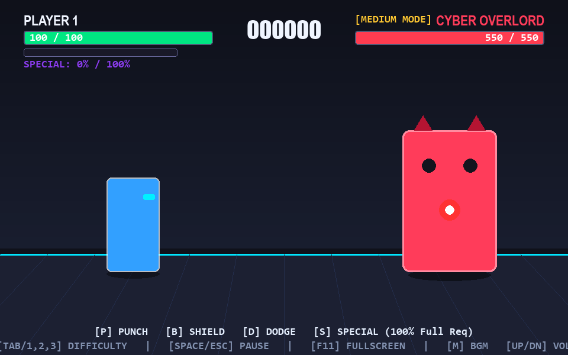
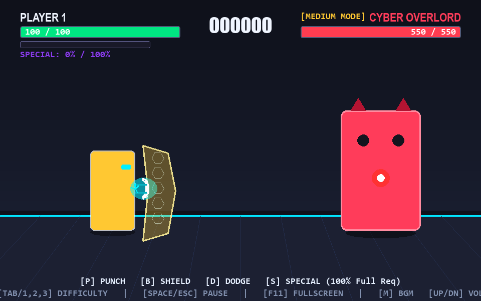
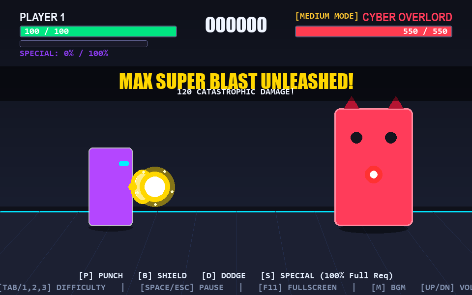
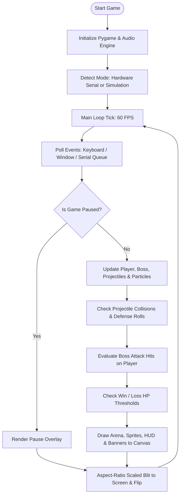
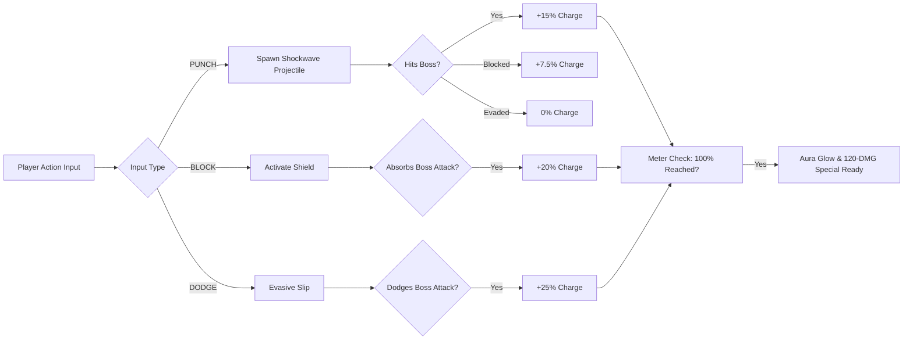

# 🥋 Edge AI Cyber Fighting Game

An arcade-style 2D motion-controlled fighting game built with Python and Pygame. The game interfaces with an **ESP32 microcontroller over USB Serial** running TinyML motion recognition (MPU6050 accelerometer/gyroscope) to translate physical gestures into real-time in-game combat. It also features a fully playable **Keyboard Simulation Mode** with dynamic difficulty presets, procedural chiptune audio, energy shockwave projectiles, and a 100% ultimate special charge mechanic.

---

## 📸 In-Game Previews

| Arena & HUD Overview | Energy Shield & Combat Defense | 100% Super Ultimate Blast |
|:---:|:---:|:---:|
|  |  |  |

---

## 📑 Table of Contents
1. [Overview & Core Features](#-overview--core-features)
2. [Hardware Integration Architecture](#-hardware-integration-architecture)
3. [Combat & Gameplay Mechanics](#-combat--gameplay-mechanics)
4. [Installation Guide (All Operating Systems)](#-installation-guide-all-operating-systems)
5. [Running the Game](#-running-the-game)
6. [Codebase Architecture & Explanations](#-codebase-architecture--explanations)
7. [System Execution Flowcharts](#-system-execution-flowcharts)
8. [Configuration & Customization](#-configuration--customization)
9. [Standalone Binary Distribution (Executable Build)](#-standalone-binary-distribution-executable-build)
10. [Troubleshooting](#-troubleshooting)

---

## 🌟 Overview & Core Features

- **Physical Gesture Control**: Connects with an ESP32 over serial at 115200 baud to read predictions (`PUNCH`, `BLOCK`, `DODGE`, `SPECIAL`).
- **Energy Shockwave Projectiles**: Player punches manifest as high-velocity sonic shockwaves travelling across the arena instead of static melee hitboxes.
- **Hexagonal Energy Barrier**: Guarding deploys an animated honeycomb forcefield mitigating incoming boss lasers by 75%.
- **Action-Driven 100% Ultimate Meter**: The special gauge charges purely through player skill (connecting hits, clean dodges, and timed blocks). At 100%, unleash a catastrophic 120-damage Super Blast.
- **Boss Defense System**: The Cyber Overlord actively counters incoming projectiles by generating red barrier blocks or backward afterimage dodges.
- **Difficulty Presets (`EASY`, `MEDIUM`, `HARD`)**: Instant level adjustment tailoring boss HP, attack frequency, damage, and reaction timing.
- **Procedural Retro Audio**: Real-time synthesized chiptune arcade music (130 BPM) and custom retro SFX using Python math waves without external audio asset dependencies.
- **Aspect-Ratio Preserved Display**: Responsive window scaling and full-screen toggle with pillarboxing/letterboxing (`F11` or `F`).

---

## 📡 Hardware Integration Architecture

```
+-------------------+      +-------------------+      +-------------------------+
| Human Movement    | ---> | MPU6050 (6-DoF)   | ---> | ESP32 Microcontroller   |
| (Punch/Block/etc) |      | Accel & Gyroscope |      | TinyML Inference Window |
+-------------------+      +-------------------+      +-------------------------+
                                                                   |
                                                            USB Serial Line
                                                            (115200 Baud)
                                                                   v
+-------------------+      +-------------------+      +-------------------------+
| Game Visual FX,   | <--- | Game State Engine | <--- | Serial Controller &     |
| HP, HUD & Audio   |      | Combat Logic      |      | Command Parser          |
+-------------------+      +-------------------+      +-------------------------+
```

### Serial Protocol
The ESP32 firmware streams predictions terminated with newlines:
```text
PUNCH
BLOCK
DODGE
SPECIAL
```
Verbose log messages from inference models (e.g., `Motion: PUNCH | Confidence: 94%`) are automatically parsed and normalized by `engine/serial_controller.py`.

---

## 🎮 Combat & Gameplay Mechanics

### Command Summary

| Command | Key | Description | Charge Gained |
|:---|:---:|:---|:---:|
| **PUNCH** | `P` | Fires an Energy Shockwave projectile across the arena. | **+15%** (on hit) |
| **BLOCK** | `B` | Deploys a hexagonal cyber shield (1.5s duration) absorbing 75% damage. | **+20%** (on absorb) |
| **DODGE** | `D` | Evasive slip avoiding 100% incoming damage (0.9s duration). | **+25%** (on evade) |
| **SPECIAL** | `S` | Catastrophic 120-damage Ultimate Blast (**Requires 100% charge**). | Consumes 100% |

### Difficulty Presets

| Difficulty | Shortcut | Boss HP | Normal Attack | Heavy Attack | Attack Interval | Defense Level |
|:---|:---:|:---:|:---:|:---:|:---:|:---|
| **EASY** | `1` | 300 | 5 | 10 | 3.6s (Very Slow) | Minimal (5% block, 2% dodge) |
| **MEDIUM** | `2` | 550 | 10 | 18 | 2.3s (Balanced) | Balanced (22% block, 15% dodge) |
| **HARD** | `3` | 850 | 22 | 40 | 1.4s (Aggressive) | High (38% block, 28% dodge) |

*You can cycle difficulty at any time by pressing `TAB` or using the `1`, `2`, `3` numeric keys.*

---

## 💻 Installation Guide (All Operating Systems)

### Prerequisites
- Python **3.9 to 3.13** installed on your system.
- Git (optional, for cloning).

---

### Windows (PowerShell / Command Prompt)

```powershell
# 1. Clone or navigate to the project directory
cd ~/path/to/GAME

# 2. Create a virtual environment
python -m venv .venv

# 3. Activate the virtual environment
# In PowerShell:
.\.venv\Scripts\Activate.ps1
# (If script execution is disabled: Set-ExecutionPolicy Unrestricted -Scope Process)
# In Command Prompt (cmd.exe):
.\.venv\Scripts\activate.bat

# 4. Upgrade pip and install dependencies
python -m pip install --upgrade pip
pip install -r requirements.txt
```

---

### macOS (Terminal - zsh / bash)

```bash
# 1. Navigate to the project directory
cd /path/to/GAME

# 2. Create a virtual environment
python3 -m venv .venv

# 3. Activate the virtual environment
source .venv/bin/activate

# 4. Upgrade pip and install dependencies
python3 -m pip install --upgrade pip
pip install -r requirements.txt
```

---

### Linux (Ubuntu / Debian / Fedora / Arch)

```bash
# 1. Install system prerequisites (SDL libraries for Pygame)
sudo apt update
sudo apt install python3-venv python3-pip libsdl2-dev libsdl2-mixer-dev -y

# 2. Navigate to project directory
cd /path/to/GAME

# 3. Create and activate virtual environment
python3 -m venv .venv
source .venv/bin/activate

# 4. Install dependencies
pip install --upgrade pip
pip install -r requirements.txt
```

---

## 🚀 Running the Game

### 1. Simulation Mode (Keyboard Only)
Test the entire game immediately without any hardware connected:
```bash
python main.py --simulation
```

### 2. Fullscreen Launch
```bash
python main.py --simulation --fullscreen
```

### 3. Hardware Mode (ESP32 Motion Controller)
Plug in your ESP32 with your TinyML firmware, verify port in `config/settings.py` (`SERIAL_PORT = "AUTO"`), and run:
```bash
python main.py
```

### Keyboard Shortcuts Reference

```text
[P] Punch          [B] Energy Shield     [D] Evasive Dodge      [S] Special Attack
[1] Easy Mode      [2] Medium Mode       [3] Hard Mode          [TAB] Cycle Difficulty
[SPACE] / [ESC]    Pause or Resume
[F11] or [F]       Toggle Fullscreen
[M]                Mute / Unmute Background Music
[UP] / [DOWN]      Adjust Master Volume (+10% / -10%)
[ANY KEY]          Continue to next round on Game Over
```

---

## 📂 Codebase Architecture & Explanations

The repository follows a clean, modular object-oriented architecture:

```text
GAME/
├── main.py                     # Entry point, display manager & aspect-ratio scaling
├── run_game.py                 # Convenience script for quick simulation start
├── requirements.txt            # Project dependencies
├── config/
│   ├── __init__.py
│   └── settings.py             # Global constants, colors, balance & difficulty presets
├── engine/
│   ├── __init__.py
│   ├── game_state.py           # Core orchestrator: HUD, collisions, win/loss, loop
│   ├── command_parser.py       # Input debouncer & action validator
│   ├── keyboard_controller.py  # Keyboard event binding & hotkey dispatch
│   ├── serial_controller.py    # Background thread reader for ESP32 USB serial
│   ├── effects.py              # Particle systems, screen shake & damage numbers
│   └── sound_effects.py        # Real-time procedural audio synthesis
└── entities/
    ├── __init__.py
    ├── player.py               # Player rendering, charge meter & shield state
    ├── boss.py                 # Boss AI, attack patterns, telegraphs & defenses
    └── projectile.py           # Energy Shockwaves & Special Plasma Blasts
```

### Key Modules Explained

#### 1. `main.py`
Initializes Pygame and manages window creation. It features an internal native rendering canvas ($960 \times 600$) and handles dynamic scaling to ensure zero distortion on any display resolution:
```python
# Aspect-ratio preserved pillarboxed / letterboxed blit
win_w, win_h = screen.get_size()
scale = min(win_w / SCREEN_WIDTH, win_h / SCREEN_HEIGHT)
scaled_surface = pygame.transform.smoothscale(canvas, (int(SCREEN_WIDTH * scale), int(SCREEN_HEIGHT * scale)))
screen.blit(scaled_surface, ((win_w - scaled_surface.get_width()) // 2, (win_h - scaled_surface.get_height()) // 2))
```

#### 2. `engine/game_state.py`
The central state machine handling:
- Projectile life-cycle and collision detection against entity hitboxes.
- Combat resolution (evaluating whether player dodged/blocked or boss deflected).
- Dynamic HUD rendering (dual-row controls, lagging health bars, charge gauge).
- Pause overlays and game over restarts.

#### 3. `engine/sound_effects.py`
Generates retro arcade sound effects and an interactive 130 BPM cyberpunk battle theme procedurally using mathematical wave formulas (`math.sin`, square wave harmonics, and noise generators) converted into raw audio buffers:
```python
# Procedural audio generated at runtime without external WAV/MP3 files
samples = array.array('h')
for i in range(total_samples):
    t = i / sample_rate
    val = generator_func(t, duration)
    samples.append(int(val * 28000))
return pygame.mixer.Sound(buffer=samples)
```

#### 4. `entities/boss.py`
Implements state-based Boss AI (`IDLE` $\rightarrow$ `PREPARE` $\rightarrow$ `ATTACK` $\rightarrow$ `RECOVER` $\rightarrow$ `IDLE`). Features an active defense evaluation:
```python
def assess_defense(self, is_special=False):
    # Calculates dodge or block rolls based on difficulty presets
    roll = random.random()
    if roll < self.config["boss_dodge_chance"]:
        return "DODGED"
    elif roll < (self.config["boss_dodge_chance"] + self.config["boss_block_chance"]):
        return "BLOCKED"
    return "HIT"
```

#### 5. `entities/player.py` & `entities/projectile.py`
Houses player state transformations (hexagonal shield rendering, color flashes) and manages ballistic energy projectiles traveling across the screen with spark trails.

---

## 📊 System Execution Flowcharts

### 1. Main Game Loop Flow



### 2. Player Input & Special Charge State Flow



---

## ⚙️ Configuration & Customization

Modify game variables directly in [`config/settings.py`](config/settings.py):

```python
# Screen Dimensions
SCREEN_WIDTH = 960
SCREEN_HEIGHT = 600

# Serial Hardware Settings
SERIAL_PORT = "AUTO"  # Set to "AUTO" or specific port e.g. "COM3", "/dev/ttyUSB0"
BAUD_RATE = 115200

# Combat Values
DMG_PUNCH = 14
DMG_SPECIAL = 120
DURATION_BLOCK = 1500  # Shield active window in milliseconds
DURATION_DODGE = 900   # Evasion active window in milliseconds
```

---

## 📦 Standalone Binary Distribution (Executable Build)

You can package the entire game into a single standalone `.exe` (or Linux/macOS executable) for easy distribution without requiring Python installed:

```bash
# In your activated virtual environment:
pyinstaller --onefile --noconsole --name "EdgeAICyberFighter" main.py
```

The resulting standalone executable will be located in the `dist/` directory.

---

## 🔧 Troubleshooting

### 1. Serial Port Connection Issues
- **Error**: `Could not auto-detect ESP32`.
- **Solution**: Open `config/settings.py` and manually set `SERIAL_PORT = "COM3"` (Windows) or `SERIAL_PORT = "/dev/ttyUSB0"` (Linux/Mac). Ensure Arduino Serial Monitor or other serial terminals are closed.

### 2. Audio Not Initializing
- **Note**: If your system lacks an active sound output device, Pygame will safely operate in silent mode without crashing. Connect headphones or speakers to enable procedural audio.

### 3. Display Scaling on High-DPI Screens
- If text appears scaled unusually on 4K/high-DPI monitors on Windows, press `F11` to toggle into native fullscreen.

---

## 📜 License
Developed for the **Edge AI & TinyML Motion Controller Workshop**. Educational and open-source demonstration project.
